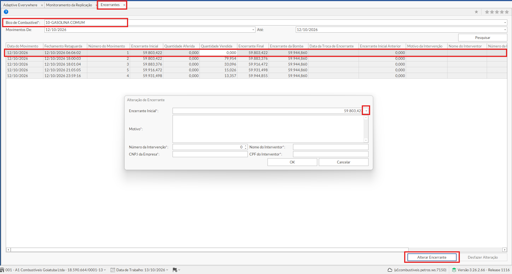

# Essa vai ser as informações que a automação vai te pedir para que você posicione o mouse (não precisa clicar em nada somente posicionar o ponteiro no mouse nessas posições).
Ordem das informações que a automação vai te pedir:
1. Posição da aba Encerrantes, 
2. Posição do placeholder, 
3. Posição Encerrante, 
4. Posição do botão Alterar Encerrante
5. Posição do botão Pegar o valor correto (seta para baixo)

# Seguindo a ordem dos retangulo vermelhos de cima para baixo

## 1 - Aba Encerrantes (Tela de Encerrantes)

## 2 - Posição do Placeholder

## 3 - Posição do Encerrante

## 4 - Posição do botão Pegar o valor correto (seta para baixo)

## 5 - Posição do Botão Alterar Encerrante

